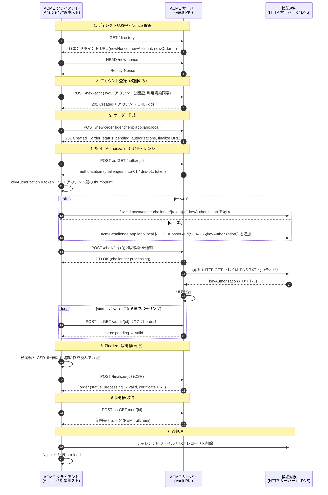
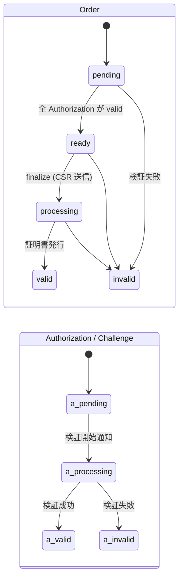

# ACME プロトコル シーケンス図

ACME（RFC 8555）で証明書を発行する流れです。クライアントは Ansible の `community.crypto.acme_certificate`、ACME サーバーは Vault の PKI（`pki_int/roles/labo-local/acme/directory`）を想定しています。

## 全体シーケンス

## 補足

- 初回以外のリクエストは、すべて JWS（JSON Web Signature）で署名され、`nonce` と `url` を含みます。アカウント登録後は `jwk` の代わりに `kid`（アカウント URL）で識別されます。
- 手順 5 の CSR のドメインは、手順 3 の `identifiers` と一致している必要があります。
- Ansible の `acme_certificate` を使う場合、手順 4 の「チャレンジ取得」と「検証開始以降」の 2 段階に分かれます。間でチャレンジの応答（ファイル配置または TXT 追加）を行います。詳細は [HOWTO-6-ACME-5.md](./HOWTO-6-ACME-5.md) を参照してください。
- 更新（renew）時は、手順 2 のアカウント登録を省略し、手順 3 以降を再実行します。

## 状態遷移

