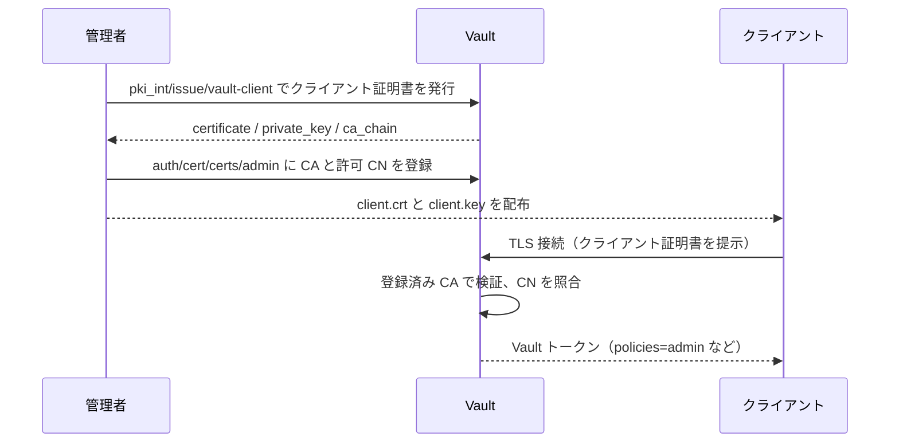

# TLS 証明書認証で Vault にログインする

Vault の `cert` 認証は、クライアント証明書（と秘密鍵）を持っていることを認証にします。パスワードは使いません。
[HOWTO-4-CA-1.md](HOWTO-4-CA-1.md) で作成した中間 CA（`pki_int`）でクライアント証明書を発行し、その CA を `cert` 認証に信頼させる構成です。

- Community Edition で使えます。
- 証明書と秘密鍵の両方が必要なので、「持っているもの」を 1 要素として使えます。ただし、パスワードなど別の要素を Vault 単体で強制することはできません（[HOWTO-7-MFA-1.md](HOWTO-7-MFA-1.md) を参照）。
- 自動処理（Ansible、CI、アプリケーション）のログインにも向いています。

前提は [HOWTO-4-CA-1.md](HOWTO-4-CA-1.md) と同じで、`pki_int/` が有効、Vault の URL は `https://vault.labo.local:8200` です。

## 流れ



## 1. クライアント証明書を発行する

### 発行用ロールを作成

サーバー証明書用の `labo-local` ロールとは分け、クライアント認証専用のロールを作ります。

```console
vault write pki_int/roles/vault-client \
    allowed_domains="labo.local" allow_subdomains=true \
    client_flag=true server_flag=false \
    key_type=ec key_bits=256 \
    max_ttl=720h
```

- `client_flag=true` で、拡張鍵用途（EKU）に `clientAuth` が入ります。
- `server_flag=false` で、サーバー証明書としては使えないようにします。
- `common_name` が、あとで `cert` 認証側の `allowed_common_names` と照合されます。

### 証明書を発行

```console
vault write -format=json pki_int/issue/vault-client \
    common_name="admin01.labo.local" ttl=24h > client.json

jq -r '.data.certificate' client.json > client.crt
jq -r '.data.private_key' client.json > client.key
jq -r '.data.ca_chain[]'  client.json > ca_chain.crt
chmod 600 client.key
```

- `private_key` は発行時の 1 回しか返りません。紛失したら再発行します。
- 証明書の内容は、次のコマンドで確認できます。

```console
openssl x509 -in client.crt -noout -subject -enddate -ext extendedKeyUsage
```

### 発行できる人の権限

発行する人（または自動化用のトークン）には、次のポリシーが必要です。

```hcl
path "pki_int/issue/vault-client" {
  capabilities = ["update"]
}
```

## 2. `cert` 認証を設定する

### 認証方式を有効にする

```console
vault auth enable cert
```

### 信頼する CA と、ログインできる証明書を登録

```console
vault write auth/cert/certs/admin \
    display_name=admin \
    certificate=@ca_chain.crt \
    allowed_common_names="admin01.labo.local" \
    token_policies="default,admin" \
    token_ttl=1h
```

| パラメータ | 内容 |
|---|---|
| `certificate` | クライアント証明書の発行元 CA（チェーン）。この CA が発行した証明書だけを受け付ける |
| `allowed_common_names` | ログインを許可する CN。ワイルドカードも使える（例: `*.labo.local`） |
| `token_policies` | ログイン後に付与するポリシー |
| `token_ttl` | 発行されるトークンの有効期間 |

> **注意:** `allowed_common_names` などの絞り込みを何も指定しないと、その CA が発行した証明書はすべてログインできます。
> `pki_int` はサーバー証明書も発行するので、必ず CN で絞ってください。`allowed_dns_sans` や `allowed_organizational_units` でも絞れます。

## 3. ログインする

### CLI のオプションで指定

```console
vault login -method=cert \
    -ca-cert=ca_chain.crt \
    -client-cert=client.crt \
    -client-key=client.key \
    name=admin
```

`name` は、`auth/cert/certs/` に登録した名前です。省略すると、提示した証明書に一致する登録をすべて探します。

### 環境変数で指定

```console
export VAULT_ADDR=https://vault.labo.local:8200
export VAULT_CACERT=ca_chain.crt
export VAULT_CLIENT_CERT=client.crt
export VAULT_CLIENT_KEY=client.key

vault login -method=cert name=admin
```

### curl で確認

```console
curl --cacert ca_chain.crt --cert client.crt --key client.key \
    --request POST --data '{"name":"admin"}' \
    https://vault.labo.local:8200/v1/auth/cert/login
```

レスポンスの `auth.client_token` が Vault トークンです。

## Vault のリスナー設定

[vault.hcl](playbook/roles/vault/templates/vault.hcl) のリスナーは、クライアント証明書の設定をしていません。
この状態でも、Vault はクライアント証明書を要求し（必須にはしない）、`cert` 認証が検証するので、上の手順でログインできます。

TLS 接続の時点でクライアント証明書を必須にしたい場合は、リスナーに次の設定を追加します。
この場合、証明書がないクライアントは `userpass` などでもログインできなくなるので、注意してください。

```hcl
listener "tcp" {
  address                          = "0.0.0.0:8200"
  tls_cert_file                    = "/opt/vault/tls/tls.crt"
  tls_key_file                     = "/opt/vault/tls/tls.key"
  tls_client_ca_file               = "/opt/vault/tls/client_ca.crt"
  tls_require_and_verify_client_cert = true
}
```

## 運用のポイント

- **短い TTL で運用:** クライアント証明書は `ttl=24h` など短くして、期限切れを待つ運用が簡単です。自動化では、ログインのたびに再発行する構成もあります。
- **失効:** 漏えいした場合は、シリアル番号を指定して失効させます。

  ```console
  vault write pki_int/revoke serial_number=<シリアル番号>
  ```

  `cert` 認証は、`auth/cert/crls/` に CRL を登録すると、失効した証明書を拒否できます。

  ```console
  curl -s https://vault.labo.local:8200/v1/pki_int/crl/pem -o int.crl
  vault write auth/cert/crls/int-2026 crl=@int.crl
  ```

  CRL は更新されるので、定期的に登録し直す必要があります。
- **中間 CA の更新:** [HOWTO-4-CA-5.md](HOWTO-4-CA-5.md) で新しい中間 CA に切り替えたら、`auth/cert/certs/` の `certificate` に新しい CA のチェーンを追加します。
- **秘密鍵の保護:** `client.key` は `chmod 600` にして、リポジトリには置かないでください。

## トラブルシュート

| 症状 | 原因と対処 |
|---|---|
| `invalid certificate or no client certificate supplied` | 証明書を提示していない、または登録した CA で検証できない。`certificate=@ca_chain.crt` を確認する |
| `permission denied` | `allowed_common_names` と証明書の CN が一致していない。`openssl x509 -noout -subject` で確認する |
| `x509: certificate signed by unknown authority` | サーバー側の検証エラー。`-ca-cert` に `ca_chain.crt` を指定する |
| `tls: bad certificate` | `client.crt` と `client.key` の組み合わせが違う、または証明書が期限切れ |

## 注意

- 設定内容は Vault の仕様を前提に書いており、実機では試していません。
