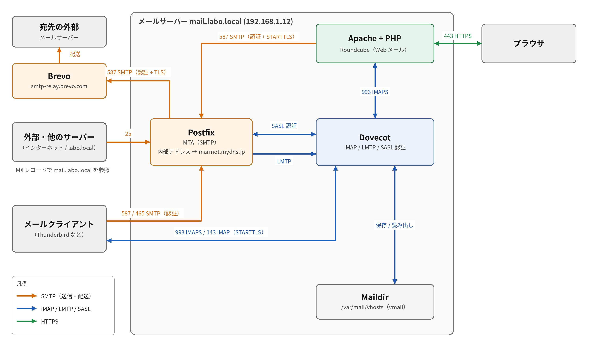

# 82-mail-server

`labo.local` ドメインのメールサーバー（Postfix + Dovecot + Roundcube）を、Marmot 仮想サーバー上に Ansible で構築します。

- サーバー間のメール交換: 宛先ドメインの **DNS の MX レコードを参照して配送**します。
- メールクライアント: **IMAP4**（STARTTLS / IMAPS）でメールを受信し、**SMTP submission**（587 / 465、認証必須）で送信します。IMAP にはメールを送る機能がないため、クライアントには受信（IMAP）と送信（SMTP）の両方を設定します。
- Web メール: **Roundcube** を `https://mail.labo.local/` に配置し、ブラウザから既存のメールユーザーで読み書きできます。
- 外向き SMTP ゲートウェイ: SMTP 配送時の内部アドレスを `marmot.mydns.jp` に変換し、認証付きで Brevo の SMTP リレーへ配送します。
- 公開ドメインの受信: `user@marmot.mydns.jp` 宛を既存の `user@labo.local` のメールボックスへ配送します。公開 DNS と外部からの TCP 25 番への到達性が必要です。

## 仮想サーバー構成

[mail-server.yaml](mail-server.yaml) で定義されています。

| 項目 | 値 |
|---|---|
| サーバー名 | `mail` |
| CPU / メモリ | 1 / 1024 MB |
| イメージ | Ubuntu 24.04 |
| IPアドレス | `192.168.1.12`（`mail.labo.local`） |
| DNS | `192.168.1.9`、検索ドメイン `labo.local`（MX レコードの参照に必要） |

## ソフトウェア構成

Ubuntu 24.04 の標準パッケージ（apt）を、Ansible で導入・設定します。バージョンはパッケージのものに従い、Playbook では固定していません。

| 役割 | ソフトウェア | パッケージ | 用途 |
|---|---|---|---|
| MTA（SMTP） | Postfix | `postfix`、`libsasl2-modules` | 25 番での受信、587 / 465 での認証付き送信（submission）、送信キュー、Brevo への SMTP リレー（SASL 認証） |
| IMAP / LMTP / 認証 | Dovecot | `dovecot-core`、`dovecot-imapd`、`dovecot-lmtpd` | IMAP（143 / 993）、Postfix からの LMTP 配送、Postfix への SMTP 認証の提供、仮想ユーザーのパスワード認証 |
| Web メール | Roundcube | `roundcube-core`、`roundcube-sqlite3`、`dbconfig-sqlite3` | ブラウザからのメール閲覧・送信。データベースは SQLite |
| Web サーバー | Apache HTTP Server + PHP | `apache2`、`libapache2-mod-php`、`php-cli` | Roundcube の HTTPS（443）公開。80 は HTTPS へのリダイレクト |
| TLS 証明書 | 自己署名の CA（`python3-cryptography`、`community.crypto`） | `python3-cryptography` | `mail_tls_mode: selfsigned` のとき、サーバー上に CA とサーバー証明書を作成。`provided` なら用意した証明書を配置 |
| 動作確認 | swaks、dig | `swaks`、`bind9-dnsutils` | SMTP の送信テスト、MX レコードの確認 |

Playbook を実行するマシンには、Ansible、`community.crypto`・`community.general` コレクション、`passlib` が必要です（次の「事前準備」を参照）。送信専用の [mail_client ロール](playbook/roles/mail_client)では、`postfix`、`bsd-mailx`、`swaks`、`bind9-dnsutils` を導入します。



この図は [image/draw_architecture.py](image/draw_architecture.py) で生成しています。変更するときはスクリプトを編集し、`python3 82-mail-server/image/draw_architecture.py` で再作成してください（Pillow と日本語フォント `fonts-noto-cjk` が必要）。

メールボックスは Maildir 形式で、Linux のアカウントを作らない仮想ユーザー（`vmail`）が所有します。

## 事前準備

DNS に次のレコードが必要です。[79-BindDNS](../79-BindDNS/playbook/vars/zones.yaml) には、すでに定義されています。

| レコード | 値 |
|---|---|
| A | `mail.labo.local` → `192.168.1.12` |
| MX | `labo.local` → `10 mail.labo.local.` |

```bash
dig +short MX labo.local            # 10 mail.labo.local.
dig +short A mail.labo.local        # 192.168.1.12
```

Playbook を実行するマシンには、Ansible、`community.crypto`・`community.general` コレクション、`passlib` が必要です。パスワードのハッシュ化に `passlib` を使います。

```bash
ansible-galaxy collection install community.crypto community.general
sudo apt install python3-passlib       # または pip install passlib
```

## 構築

```bash
cd 82-mail-server
mactl create -f mail-server.yaml
```

[mail-server.yaml](mail-server.yaml) の `spec.ansible` により、仮想サーバーの起動後に Playbook が自動で実行されます。Playbook のみを手動で実行する場合は、次のコマンドを使います。

```bash
ansible-playbook -i playbook/hosts.yaml playbook/install.yaml
```

外向き SMTP は既定で Brevo のリレーを使います。Playbook は Vault で暗号化した SMTP key（`mail_relay_password`）を必要とするため、先に「[SMTP key を Ansible Vault で保存する](#smtp-key-を-ansible-vault-で保存する)」の手順で `secrets.yaml` を作成し、上記のコマンドに `--ask-vault-pass -e @secrets.yaml` を付けて実行してください。`mactl create` の自動実行は Vault のパスワードを渡せないため、SMTP key の検証で失敗します。その場合も仮想サーバーは作成済みなので、手動で実行してください。

Playbook は、実行の最後に **DNS の MX レコードがこのサーバー（`mail_hostname`）を指していること**を確認します。指していない場合は失敗するため、DNS を修正して再実行してください。

## 構成

| ファイル | 内容 |
|---|---|
| [playbook/install.yaml](playbook/install.yaml) | エントリーポイント。`mail_servers` に `mail_server`、`mail_clients` に `mail_client` を適用 |
| [playbook/hosts.yaml](playbook/hosts.yaml) | インベントリ。`mactl-ssh` 経由で SSH 接続 |
| [playbook/group_vars/all.yaml](playbook/group_vars/all.yaml) | ドメイン、ユーザー、別名 |
| [playbook/roles/mail_server](playbook/roles/mail_server) | Postfix + Dovecot + Roundcube の構築（変数は `defaults/main.yaml`） |
| [playbook/roles/mail_client](playbook/roles/mail_client) | 送信専用の Postfix（他のサーバー用、任意） |

### メールサーバー（mail_server）

1. Postfix、Dovecot（IMAP / LMTP）、動作確認用ツール（`swaks`、`dig`）をインストール
2. メールボックス用のユーザー `vmail`（uid 5000）を作成。メールは `/var/mail/vhosts/<ドメイン>/<ユーザー>/Maildir` に保存
3. TLS 証明書を用意（`mail_tls_mode`。後述）
4. Dovecot を設定: IMAP（143 は STARTTLS 必須、993 は TLS）、パスワードファイル認証、Postfix への LMTP 配送、Postfix への SMTP 認証の提供
5. Postfix を設定: 受信、MX 参照による送信、`submission`（587）と `smtps`（465）の追加
6. Roundcube、Apache + PHP、SQLite をインストールし、既存の証明書で HTTPS を設定。Roundcube は IMAPS と SMTP STARTTLS で接続し、サーバー証明書を検証
7. ポートの待ち受け、Roundcube のログインページ、MX レコードを確認

メールボックスは Linux のアカウントを作らない仮想ユーザーです。ログインやシェルは使えません。

| ポート | 用途 | 認証 |
|---|---|---|
| 25 | サーバー間のメール配送（受信） | 不要。**`labo.local` と `marmot.mydns.jp` の登録済み宛先を受け付け、他ドメインへの未認証中継は拒否** |
| 587 | メールクライアントの送信（STARTTLS） | 必須 |
| 465 | メールクライアントの送信（TLS）。`mail_enable_smtps: false` で無効化 | 必須 |
| 143 | IMAP（STARTTLS 必須。平文ログインは拒否） | 必須 |
| 993 | IMAPS（TLS） | 必須 |
| 443 | Roundcube（HTTPS） | メールユーザーでログイン |
| 80 | HTTPS へのリダイレクト | メールの読み書きには使用しない |

### メールの流れ

| 経路 | 動作 |
|---|---|
| 他のサーバー → `user@labo.local` | 送信側が MX レコードで `mail.labo.local` を引き、25 番ポートへ配送。Postfix が Dovecot（LMTP）経由でメールボックスに保存 |
| 外部 → `user@marmot.mydns.jp` | 公開 MX 経由で受信し、`user@labo.local` の既存メールボックスへ配送 |
| クライアント → 他ドメイン | 587 / 465 で認証して送信。内部アドレスを公開ドメインへ変換し、Brevo の SMTP リレー経由で配送 |
| クライアント ← メールボックス | IMAP で受信 |
| ブラウザ ↔ Roundcube | HTTPS で操作。Roundcube が 993 で受信、587 で認証して送信 |

外部のインターネットへ配送するには、仮想サーバーから外部への SMTP（25 番ポート）が通る必要があります。

### 送信側のサーバー（mail_client、任意）

`labo.local` の他のサーバーから、cron や監視のメールをこのサーバーへ送るための、送信専用の Postfix です。受信はせず（`loopback-only`）、宛先のないユーザー名（`root` など）は `<ユーザー>@labo.local` として MX 宛に配送します。

[playbook/hosts.yaml](playbook/hosts.yaml) の `mail_clients` にホストを追加して実行します。

```yaml
    mail_clients:
      hosts:
        web01:
        app01:
```

## 設定する変数

[playbook/group_vars/all.yaml](playbook/group_vars/all.yaml) の主な変数です。

| 変数 | 既定値 | 説明 |
|---|---|---|
| `mail_domain` | `labo.local` | メールドメイン |
| `mail_hostname` | `mail.labo.local` | メールサーバーの FQDN。DNS の MX の宛先と一致させる |
| `mail_outbound_domain` | `marmot.mydns.jp` | SMTP 配送時の公開ドメインと EHLO 名。空文字列なら変換しない（ロール単体の既定値は空） |
| `mail_relay_enabled` | `true` | 外部 SMTP リレーを使う。`false` なら宛先 MX へ直接配送（外向き TCP 25 番が必要） |
| `mail_relay_host` | `smtp-relay.brevo.com` | 外部 SMTP リレーのホスト名（既定は Brevo） |
| `mail_relay_port` | `587` | 外部 SMTP リレーのポート（STARTTLS） |
| `mail_relay_username` | `c4d180001@smtp-brevo.com` | SMTP リレーのログイン名（Brevo アカウント固有） |
| `mail_relay_password` | なし（必須） | Brevo の SMTP key。**Vault で渡す**。Web ログイン用パスワードではない |
| `mail_users` | `admin`、`user1` | メールボックスを持つユーザー。**パスワードは仮値** |
| `mail_aliases` | `postmaster`、`root`、`abuse`、`hostmaster` → `admin` | 別名 |
| `mail_alias_domains` | `[marmot.mydns.jp]` | 登録済みユーザーと別名宛を内部メールボックスへ配送する受信用ドメイン。未登録の宛先は拒否 |

[roles/mail_server/defaults/main.yaml](playbook/roles/mail_server/defaults/main.yaml) の主な変数です。

| 変数 | 既定値 | 説明 |
|---|---|---|
| `mail_enable_smtps` | `true` | 465 番ポートを待ち受ける |
| `mail_mynetworks` | ループバックのみ | 認証なしで中継を許可するネットワーク。通常は変更しない |
| `mail_message_size_limit` | 26214400 | 1通の最大サイズ（バイト） |
| `mail_check_mx` | `true` | 実行の最後に MX レコードを確認する |
| `mail_configure_ufw` | `false` | UFW でメール関連のポートを開放する |
| `mail_roundcube_enabled` | `true` | Roundcube を導入する。`mail_configure_ufw: true` の場合は 80 / 443 も開放 |
| `mail_tls_mode` | `selfsigned` | TLS 証明書の入手方法（後述） |

### ユーザーの追加・パスワード変更

`mail_users` を編集して、Playbook を再実行します。**パスワードは必ず変更してください。**

```bash
ansible-playbook -i playbook/hosts.yaml playbook/install.yaml \
  -e '{"mail_users":[{"name":"admin","password":"強いパスワード"},{"name":"user1","password":"強いパスワード"}]}'
```

`ansible-vault` で暗号化した変数ファイルを使うのが安全です。作成済みのハッシュを使う場合は、`password` の代わりに `password_hash: "{SHA512-CRYPT}$6$..."` を指定します（`doveadm pw -s SHA512-CRYPT` で生成）。ユーザーを削除してもメールボックスのデータは削除されません。

## TLS 証明書

`mail_tls_mode` で選択します。証明書は `/etc/mail-server/tls/server.crt` と `server.key` に配置されます。

| `mail_tls_mode` | 内容 |
|---|---|
| `selfsigned`（既定） | サーバー上にプライベート CA を作成し、サーバー証明書を自動発行する |
| `provided` | 別途用意した証明書と秘密鍵（Ansible 実行マシン上のファイル）を配置する |

`provided` の例:

```yaml
mail_tls_mode: provided
mail_tls_cert_src: /path/to/mail.labo.local.fullchain.crt   # 必須
mail_tls_key_src: /path/to/mail.labo.local.key              # 必須
mail_tls_ca_src: /path/to/labo-ca.crt                       # 任意
```

`selfsigned` の場合は、メールクライアントに CA 証明書を信頼させてください。

```bash
scp ubuntu@mail.labo.local:/etc/mail-server/tls/ca.crt ./mail-labo-ca.crt
```

サーバー間の配送（25 番ポート）は、証明書を検証しない opportunistic TLS（`may`）です。

## メールクライアントの設定

| 項目 | 値 |
|---|---|
| ユーザー名 | `admin@labo.local`（`admin` でも可） |
| 受信 (IMAP) | `mail.labo.local`、ポート 143（STARTTLS）または 993（SSL/TLS） |
| 送信 (SMTP) | `mail.labo.local`、ポート 587（STARTTLS）または 465（SSL/TLS） |
| 認証 | 通常のパスワード認証（IMAP / SMTP とも同じ） |

接続先は IP アドレスではなく、証明書の名前（`mail.labo.local`）にしてください。

## Web ブラウザでの利用（Roundcube）

既存のサーバーにも、通常の Playbook 再実行で追加できます。既存の `mail_users` のパスワードやハッシュを維持して実行してください。

```bash
ansible-playbook -i playbook/hosts.yaml playbook/install.yaml
```

1. `selfsigned` 構成の場合は、「TLS 証明書」の手順で取得した `mail-labo-ca.crt` を、ブラウザまたは OS の信頼する CA に登録します。HTTPS の証明書エラーを無視せず、`https://mail.labo.local/` を開いてください。
2. ユーザー名に `admin@labo.local` または `user1@labo.local`、パスワードに `mail_users` で設定した値を入力してログインします。`admin`、`user1` の省略形も使えます。別名の `postmaster` などはログイン用アカウントではありません。
3. **メール**画面の受信箱でメッセージを選び、内容を読みます。**作成**から宛先・件名・本文を入力し、**送信**します。添付は作成画面から追加できます（既定の PHP 設定では 1 ファイル最大 2 MB）。
4. **返信**・**全員に返信**・**転送**で返信や転送ができます。送信済みメールは **Sent**、下書きは **Drafts** に保存されます（表示名は言語設定によって異なります）。
5. 利用後は **ログアウト**します。Roundcube 専用のユーザー登録は不要で、既存の Dovecot / SMTP 認証を使います。Keycloak SSO はこの構成には含みません。

動作確認には `user1` でログインし、`admin@labo.local` にテストメールを送ります。一度ログアウトし、`admin` でログインして受信・返信を確認してください。同じメールボックスを通常の IMAP クライアントでも参照できます。

Roundcube の設定は [roundcube.yaml](playbook/roles/mail_server/tasks/roundcube.yaml) と [roundcube-config.inc.php.j2](playbook/roles/mail_server/templates/roundcube-config.inc.php.j2) が管理します。パッケージが生成するセッション暗号化キーと DB 設定はそのまま維持します。SQLite は連絡先・ユーザー設定・セッション用で、メール本体は引き続き `/var/mail/vhosts` に保存されます。

- Roundcube DB: `/var/lib/dbconfig-common/sqlite3/roundcube/roundcube`（バックアップ対象）
- Roundcube 設定: `/etc/roundcube/`（暗号化キーも含むため、バックアップは秘密情報として保護）
- Roundcube ログ: `/var/log/roundcube/`
- Apache ログ: `/var/log/apache2/roundcube-error.log`、`roundcube-access.log`

ログインや送信に失敗する場合は、ユーザー名・パスワード、`mail.labo.local` の名前解決、証明書の信頼を確認し、上記のログと Postfix / Dovecot のログを調べてください。`provided` でプライベート CA を使う場合は `mail_tls_ca_src` に CA 証明書を指定します。証明書検証は無効にしません。

新規構築時に Web メールを不要とする場合は `mail_roundcube_enabled: false` を設定します。導入済みのパッケージやサイトを削除・停止する設定ではありません。

## 動作確認

DNS と MX レコード:

```bash
dig +short MX labo.local
```

別のサーバー（`mail_client` を適用済み）から送信し、`admin` に届くことを確認します。

```bash
echo "test" | mail -s "test from $(hostname)" admin@labo.local
```

メールサーバー上で、配送ログとメールボックスを確認します。

```bash
sudo journalctl -t postfix/smtpd -t postfix/lmtp --no-pager | tail
sudo find /var/mail/vhosts -path '*/new/*' -type f
```

メールクライアントと同じ手順（認証付き送信）で、SMTP を確認します。

```bash
swaks --server mail.labo.local --port 587 --tls --tls-ca-path ./mail-labo-ca.crt \
  --auth LOGIN --auth-user user1 --auth-password '<パスワード>' \
  --from user1@labo.local --to admin@labo.local
```

IMAP を確認します。

```bash
openssl s_client -connect mail.labo.local:993 -CAfile ./mail-labo-ca.crt -quiet
# a login admin <パスワード>
# b list "" "*"
```

他ドメイン宛が MX を参照することは、キューとログで確認します。

```bash
sudo postqueue -p
sudo journalctl -t postfix/smtp --no-pager | tail
```

## Brevo SMTP リレー

`mail.labo.local` の Postfix が送信キューを管理し、認証付き TLS で Brevo の SMTP リレーへ送信します。宛先 MX の検索と外部への配送は Brevo が行います。

```text
内部サーバー／Roundcube
  → mail.labo.local:587（認証 + STARTTLS）
  → Postfix の送信キュー
  → smtp-relay.brevo.com:587（認証 + TLS）
  → 宛先メールサーバー
```

仮想サーバーから外部へ TCP 587 番で接続できる必要があります。外向き TCP 25 番の開放は不要です。

### SMTP key を Ansible Vault で保存する

SMTP key は秘密情報です。リポジトリに平文で保存せず、Ansible Vault で暗号化して `mail_relay_password` として渡します。

1. Brevo の管理画面で SMTP key を発行します（SMTP & API の SMTP）。ログイン名は `mail_relay_username` に設定した SMTP ログイン名です。**Brevo アカウントの Web ログインパスワードではなく、発行した SMTP key** を使います。
2. 暗号化ファイルを作成します。Vault のパスワード（SMTP key とは別のもの）の入力が求められ、続けてエディタが開きます。

   ```bash
   cd 82-mail-server
   ansible-vault create secrets.yaml
   ```

3. エディタに次の1行だけを書いて保存します。`キー: 値` の形式にしないと、実行時に `could not be made into a dictionary` になります。

   ```yaml
   mail_relay_password: "Brevo の SMTP key"
   ```

4. Playbook を実行します。

   ```bash
   ansible-playbook -i playbook/hosts.yaml playbook/install.yaml \
     --ask-vault-pass -e @secrets.yaml
   ```

書式の確認と SMTP key の更新は次のとおりです。確認コマンドは値を伏せて表示します。

```bash
ansible-vault view secrets.yaml | sed 's/:.*/: ***/'   # mail_relay_password: *** と表示されること
ansible-vault edit secrets.yaml                         # SMTP key を再発行したときに更新する
```

Vault のパスワードをファイルに保存して使う場合は、リポジトリの外に置き、権限を `0600` にします。`--ask-vault-pass` の代わりに `--vault-password-file ~/.vault_pass` を指定します。

`secrets.yaml` は暗号化されていますが、[.gitignore](.gitignore) でコミット対象から除外しています。Vault のパスワードは紛失すると復元できないため、パスワードマネージャーなどで管理してください。

Playbook は、認証情報を `/etc/postfix/sasl_passwd` に root のみ読み取り可能な権限で配置し、Postfix 用のマップを作成します。`mail_relay_password` が空のまま実行すると、設定の検証で失敗します。

### アドレス変換と確認

内部のログイン名、Roundcube の URL、メールボックスの保存先は変わりません。SMTP 配送時のみ、Postfix の `smtp_generic_maps` で以下のように変換します。

| 内部のアドレス | 外向き SMTP 配送時のアドレス |
|---|---|
| `admin@labo.local` | `admin@marmot.mydns.jp` |
| `user1@labo.local` | `user1@marmot.mydns.jp` |
| `root@mail.labo.local` | `root@marmot.mydns.jp` |

ローカル配送は Dovecot の LMTP を使用するため、この変換を行いません。SMTP 変換はエンベロープと `From`・`Reply-To` などのヘッダー内のアドレスに適用されます。Postfix の仕様上、送信者だけでなく該当する受信者アドレスにも適用されます。内部宛と外部宛に同時送信した場合、内部のコピーは変換前、外部のコピーは変換後になります。公開ドメイン以外の送信元をすべて置き換える設定ではありません。

変換を無効にする場合は `mail_outbound_domain: ""` にして再実行します。`smtp_generic_maps` が空になり、EHLO は内部ホスト名へ戻ります。

### 内部サーバーからゲートウェイへ送信する

送信側のアプリケーションには、SMTP サーバー `mail.labo.local`、ポート `587`、STARTTLS、既存のメールユーザーによる認証を設定します。Roundcube は既にこの経路を使用します。

この Playbook の `mail_client` ロールは、従来どおり宛先 MX への直接配送用です。外部宛もこのゲートウェイを経由させる場合は、アプリケーションで上記の認証付き submission を使ってください。**内部ネットワーク全体を `mail_mynetworks` に追加して、認証なしの外部中継を開放する必要はありません。**

### DNS とリレーの確認

- `marmot.mydns.jp` の A レコードは引き続き EHLO 名などに使います。MyDNS アカウントや IP 更新処理を Playbook に保存・追加するものではありません。
- 仮想サーバーから `smtp-relay.brevo.com:587` への接続が必要です。外向き TCP 25 番への接続は使いません。
- MyDNS の MX は、`marmot.mydns.jp` **宛の受信先**です。外向き配送先を指定するものではありません。公開ドメイン宛の受信については次の「公開ドメイン宛のメールを受信する」を参照してください。
- Brevo 側のドメイン認証（DKIM/SPF）も設定してください。中継先を変更しただけでは、送信ドメインの認証設定は完了しません。

### 外向き配送を確認する

メールサーバー上でリレー設定を確認します。

```bash
postconf relayhost smtp_host_lookup smtp_helo_name smtp_generic_maps
postmap -q @labo.local texthash:/etc/postfix/smtp-generic
dig +short A marmot.mydns.jp
```

`relayhost` が `[smtp-relay.brevo.com]:587`、`smtp_helo_name` が `marmot.mydns.jp`、マップの問い合わせ結果が `@marmot.mydns.jp` であることを確認します。SMTP 認証情報は `postconf` の出力に含まれません。

内部端末で、CA 証明書を指定してテスト送信します。`--auth-password` の値は省略して対話入力し、パスワードを履歴に残さないようにします。`--protect-prompt` と `--auth-hide-password` で入力と通信ログへのパスワード表示も抑止します。宛先には自分が管理する外部アドレスを指定してください。

```bash
swaks --server mail.labo.local --port 587 --tls --tls-verify \
  --tls-ca-path ./mail-labo-ca.crt \
  --auth LOGIN --auth-user user1 --auth-password \
  --protect-prompt --auth-hide-password \
  --from user1@labo.local --to '<自分の外部メールアドレス>'
```

submission が受け付けた時点では、外部への配送完了とは限りません。`sudo postqueue -p` と `sudo journalctl -t postfix/smtp --no-pager` で、Brevo リレーへの配送が `status=sent` になったことを確認します。さらに外部の受信箱で `From` と `Return-Path` が `user1@marmot.mydns.jp` になっていることを確認してください。接続できない場合は TCP 587 番の疎通、Vault から渡した SMTP key、Brevo の送信ドメイン認証を確認してください。

## 公開ドメイン宛のメールを受信する

`mail_alias_domains` に `marmot.mydns.jp` を設定しているため、通常の Playbook 再実行で受信を有効にします。メールボックスやログイン名は変更しません。

```bash
cd 82-mail-server
ansible-playbook -i playbook/hosts.yaml playbook/install.yaml
```

| 公開アドレス | 配送先 |
|---|---|
| `admin@marmot.mydns.jp` | `admin@labo.local` |
| `user1@marmot.mydns.jp` | `user1@labo.local` |
| `postmaster@marmot.mydns.jp`、`root@marmot.mydns.jp` などの別名 | `admin@labo.local` |

別名ドメインのアドレスは `mail_users` と `mail_aliases` にある宛先だけを明示的にマッピングします。未登録の宛先は SMTP で拒否し、全アドレスを受け付ける catch-all にはしません。Roundcube では引き続き `admin@labo.local` などでログインして受信箱を確認します。

外部からの受信には次の設定も必要です。Playbook は MyDNS やルーターを変更しません。

- 公開 MX の宛先ホストの A レコードが、ルーターのグローバル IPv4 アドレスを指していること。
- ルーターの **外部 TCP 25 → `192.168.1.12:25`** のポート転送と、回線・ファイアウォール側の許可。外向き25番の開放とは別です。
- この Playbook の Postfix は既定で IPv4 のみです。MX ホストに AAAA がある場合は、IPv6 SMTP も到達可能にするか、メール用 MX ホストを IPv4 のみにしてください。同じ名前の AAAA を変更する場合は他サービスへの影響も確認してください。

メールサーバー上で設定を確認します。

```bash
sudo postconf virtual_alias_domains virtual_alias_maps
sudo postmap -q admin@marmot.mydns.jp texthash:/etc/postfix/virtual
sudo postmap -q postmaster@marmot.mydns.jp texthash:/etc/postfix/virtual
sudo journalctl -t postfix/smtpd -t postfix/lmtp --since "30 minutes ago" --no-pager
```

マップの問い合わせ結果は、どちらも `admin@labo.local` です。Gmail など外部から `admin@marmot.mydns.jp` へテスト送信し、LMTP の `status=sent` と Roundcube の受信箱を確認してください。`Relay access denied` なら受信ドメインの反映、`User unknown` なら登録済み宛先、接続ログ自体がなければ公開 DNS・IPv4 ポート転送・IPv6 経路を確認します。

## 注意事項

- `mail_users` のパスワードは**ラボ用の仮値**です。実際に使う前に変更するか、`ansible-vault` で上書きしてください。
- 受信用の 25 番ポートは認証なしで開いていますが、受け付けるのは `labo.local`（と別名ドメイン）宛のみで、他ドメインへの中継（オープンリレー）はしません。
- 外部のインターネットへの送信は、仮想サーバーの送信元 IP に対する逆引き（PTR）、SPF、DKIM などがないと、受信側に拒否または迷惑メール扱いされる場合があります。公開ドメインへの変換だけで到達性や到達率が保証されるものではありません。
- `.local` は mDNS の予約名です。systemd-resolved や avahi を使うクライアントでは、DNS ではなく mDNS で解決されることがあります。MX レコードを参照できない場合は、[79-BindDNS](../79-BindDNS/README.md) の「ドメイン名」の注意を確認してください。
- DNS のレコードを変更したら、[79-BindDNS](../79-BindDNS/README.md) の手順に従って DNS を更新し、メールサーバーの Playbook を再実行して MX レコードを確認してください。
- メールボックスは `/var/mail/vhosts` に保存されます。サーバーのルートディスク上にあるため、大量のメールを保存する場合は、別ディスクをマウントしてください。バックアップも別途検討してください。
- Dovecot と Postfix の設定は、Playbook が管理しています。サーバー上で直接変更した内容は、次回の実行で上書きされます。
